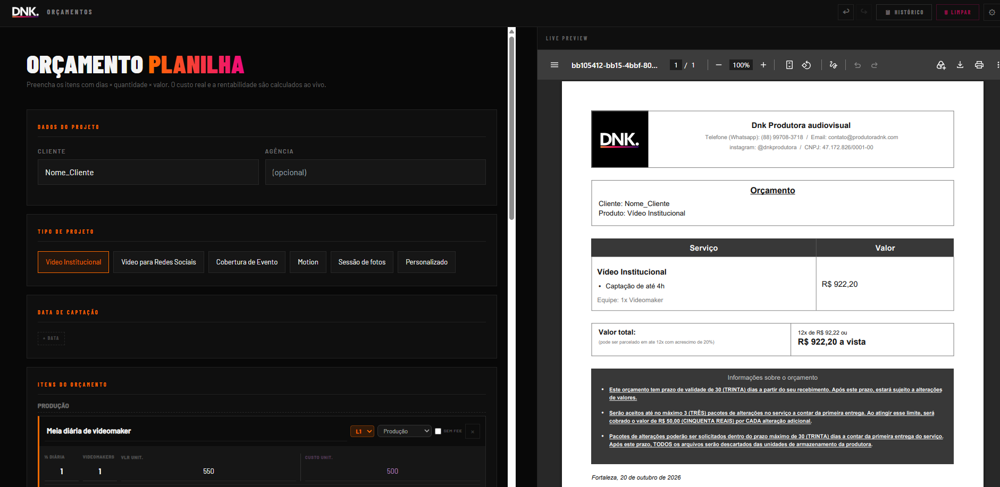
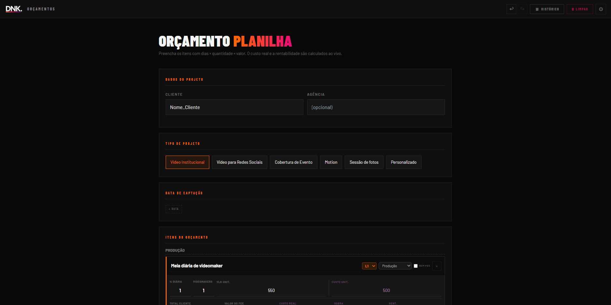
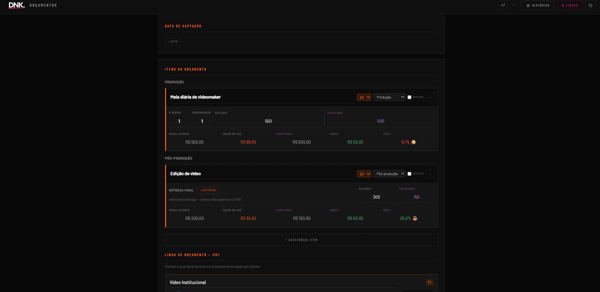
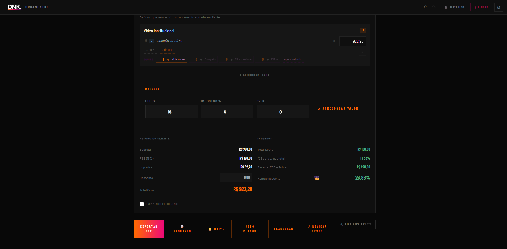

# DNK Orçamentos

Ferramenta web para criar orçamentos padronizados na [DNK Produtora](https://produtoradnk.com): calcula custos, impostos e rentabilidade em tempo real, monta o texto da proposta, gera o PDF e registra tudo automaticamente no CRM e no Drive.

> Projeto de uso interno, hospedado em domínio privado com acesso por senha. O código não está público; este repositório documenta o funcionamento e a arquitetura.



## O problema

Os orçamentos eram feitos a partir de um modelo no Google Docs. Isso trazia três problemas:

- **Falta de padrão:** o resultado mudava conforme quem da equipe fazia
- **Lentidão:** difícil de montar fora do computador
- **Nenhum registro estruturado:** o orçamento não alimentava nenhum controle comercial

## A solução

- Orçamentos **100% padronizados**, independente de quem faz
- Feitos **pelo celular**, em poucos minutos
- **Rentabilidade visível** antes de enviar a proposta
- Cada orçamento entra automaticamente no **CRM**
- **Backup automático** no Google Drive e no histórico da própria ferramenta

## Como funciona

### 1. Dados e tipo de projeto
Cliente, agência (opcional), datas de captação e o tipo de projeto: vídeo institucional, vídeo para redes sociais, cobertura de evento, motion, sessão de fotos ou personalizado.



### 2. Itens e custos
Cada item (ex: meia diária de videomaker, edição de vídeo) é lançado com quantidade, número de profissionais, valor cobrado e custo real, separado em produção e pós-produção. Para cada linha a ferramenta mostra, ao vivo, o total para o cliente, o valor do fee, o custo real, a sobra e o **percentual de rentabilidade**.



### 3. Margens e resumo
Fee, impostos e BV (bonificação de agência) em percentual, desconto e botão para arredondar o valor final. O resumo separa o que o cliente vê (subtotal, fee, impostos, total) dos números internos (sobra, receita e rentabilidade do projeto). Também permite marcar o orçamento como recorrente.



### 4. Texto da proposta e PDF
O texto que o cliente vai ver é montado em linhas, com equipe e entregas preenchidas automaticamente. Um **live preview** mostra o PDF enquanto ele é editado, já com as condições de parcelamento e as cláusulas padrão da produtora. No final, a proposta é exportada em PDF.

### 5. Registro automático
Ao finalizar, o orçamento é salvo no Drive, registrado no CRM (Google Sheets) e sincronizado com o Trello.

## Outros recursos

- Histórico de orçamentos e rascunhos
- Desfazer e refazer
- Modo planos (para pacotes com mais de uma opção)
- Biblioteca de cláusulas
- Revisão de texto antes de exportar

## Arquitetura

```
Frontend (React + Vite + Tailwind)
        │
        ▼
Google Apps Script (backend)
        │
   ┌────┼──────────────┬───────────────┐
   ▼    ▼              ▼               ▼
 Drive  Sheets (CRM)   Trello      Histórico
 (PDF)  registro do    card do      interno
        orçamento      orçamento
```

O CRM é lido e atualizado pelo [DNK Bot](link-do-repo) no WhatsApp, onde os orçamentos em aberto são acompanhados e marcados como aprovados ou reprovados.

## Evolução

A primeira versão era um único arquivo HTML com cerca de 3.100 linhas de HTML, CSS e JavaScript puros. A migração para **React + Vite + Tailwind** trouxe:

- **Rascunho salvo automaticamente**, mesmo fechando a aba
- **Preview do PDF em tempo real**
- Código organizado em componentes, mais fácil de manter e evoluir

O backend em Apps Script foi mantido durante a migração.

## Stack

| Camada | Tecnologia |
|---|---|
| Frontend | React, Vite, Tailwind CSS |
| Backend | Google Apps Script |
| Armazenamento | Google Drive, Google Sheets |
| Integrações | Trello |

## Uso

Em produção. Todos os orçamentos da DNK dos últimos 4 meses foram feitos pela ferramenta.

## Desenvolvimento

Desenvolvido por Bruno Bezerra de Matos com apoio do Claude (Anthropic), sendo responsável pela concepção, regras de negócio, arquitetura, integrações e manutenção em produção.
